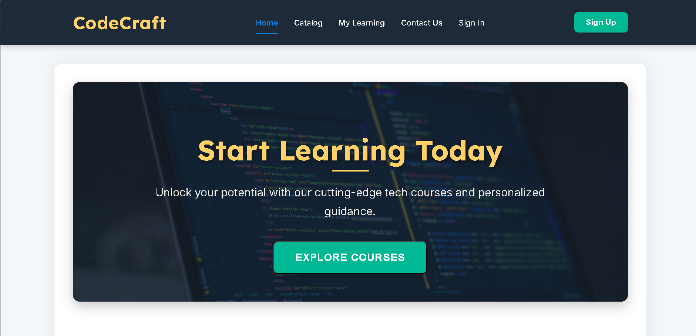
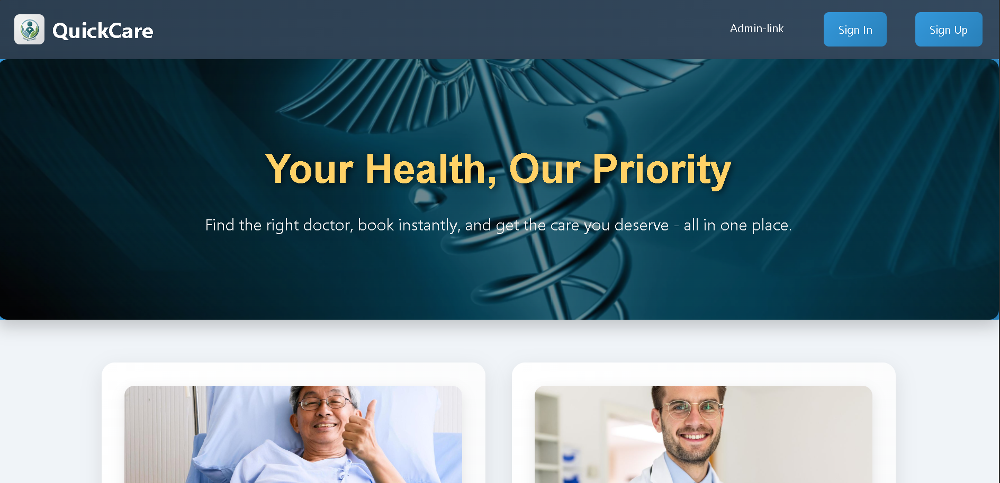
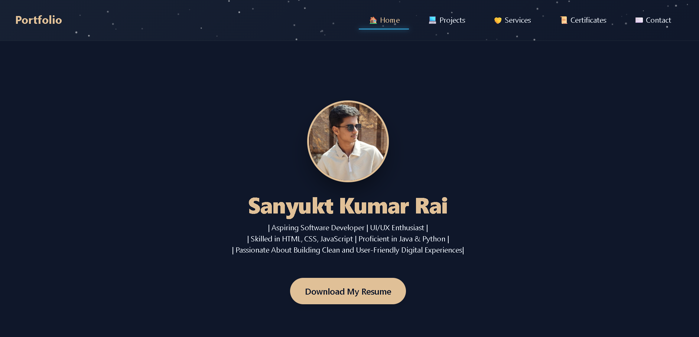

# 🌐 Sanyukt Kumar Rai — Portfolio

Personal portfolio website showcasing projects, skills, certificates, and developer work.

## ✨ What you'll find

- 👨‍💻 About and developer profile
- 🚀 Featured projects
- 🏆 Certificates and achievements
- 📄 Resume
- 📬 Contact section
- 🎨 Responsive interface

## 🖼️ Featured Projects

| Project | Preview |
| --- | --- |
| [CodeCraft](https://github.com/sanyukt63/CodeCraft) | [](https://github.com/sanyukt63/CodeCraft) |
| [Quick-Cure](https://github.com/sanyukt63/Quick-Cure) | [](https://github.com/sanyukt63/Quick-Cure) |
| Portfolio | [](./index.html) |

## 🚀 Run Locally

Clone the repository:

```bash
git clone https://github.com/sanyukt63/Portfolio-website.git
cd Portfolio-website
```

You can open `index.html` directly in a browser. For a local HTTP preview, run:

```bash
python -m http.server 8000
```

Then visit [http://localhost:8000](http://localhost:8000). Stop the server with `Ctrl+C`.

This is a static HTML/CSS/JavaScript site; the repository does not require an npm install step to preview the pages.

## 📁 Main Pages

- `index.html` — home
- `projects.html` — projects
- `certificates.html` — certificates
- `contacts.html` — contact
- `services.html` — services

## 📄 Resume

The repository includes a PDF copy of the resume: [CV-Sanyukt Kumar Rai.pdf](./CV-Sanyukt%20Kumar%20Rai.pdf).

## 📱 Responsive Design

The portfolio is intended to work across desktop and mobile layouts. When making UI changes, check navigation, project cards, the resume section, and the contact section at both narrow and wide viewport sizes.

## ♿ Accessibility checks

After changing navigation, project cards, or other interactive sections, verify:

- Every interactive control is reachable and usable with a keyboard.
- Focus indicators are visible and the focus order is logical.
- Links have descriptive text and informative images have useful alternative text.
- Heading levels follow a logical page structure.
- Text and interactive states remain legible at narrow viewport widths.
- Animations respect the user's reduced-motion preference.

These are smoke checks, not a substitute for broader browser and assistive-technology testing.

## 🤝 Contributing

This is primarily a personal portfolio, but suggestions and improvements are welcome through issues or pull requests.

⭐ If you find the portfolio useful or want to follow the project, consider starring the repository.
